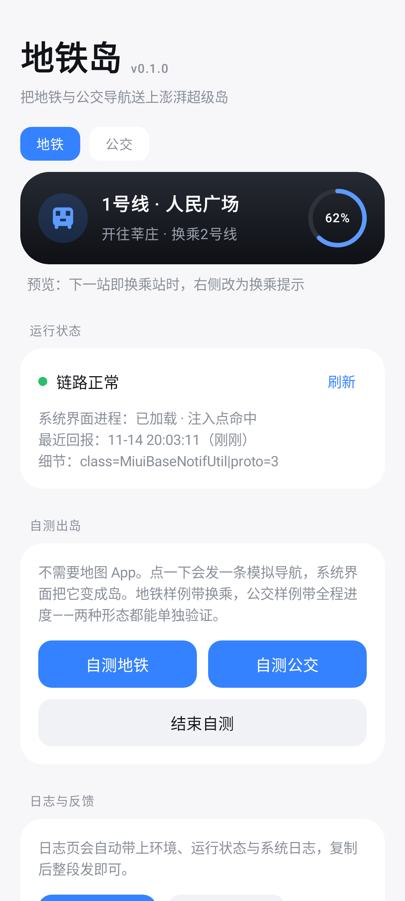
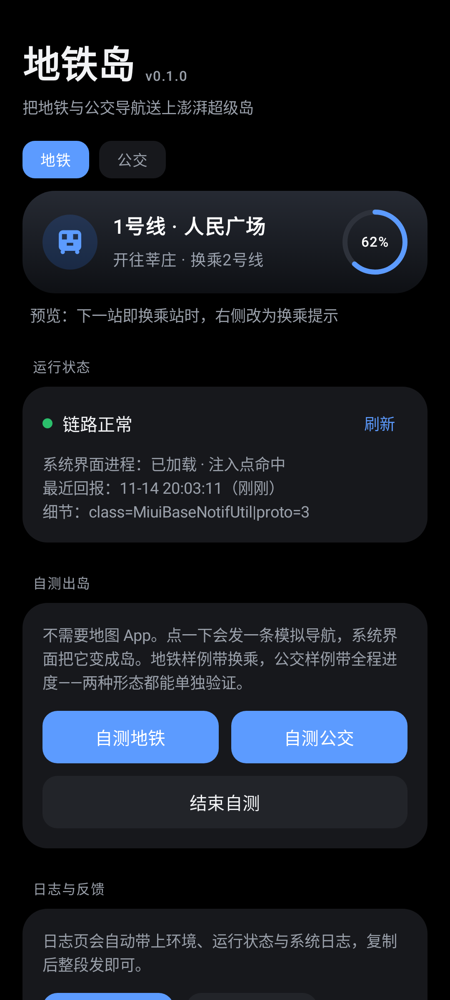

# 地铁岛 SubwayIsland

把**百度地图 / 高德地图 / 腾讯地图**的地铁导航投射到澎湃 HyperOS 的**超级岛**上：
当前线路、下一站、终点方向、剩余站数、全程进度与预计到达时间，一眼可见，不用来回切 App。


<p align="center">
  
  
</p>

---

## 缘起

用小米手机坐地铁时发现一个缺口：超级岛能装音乐、外卖、打车、倒计时，唯独没有地铁。
地图 App 明明会为导航推一条常驻通知，写着下一站和剩余站数，可它永远只是通知——不会上岛。

于是我用 AI 写了这个模块，把地铁导航里最需要低头看的那几件事搬上去：
坐的是几号线、下一站叫什么、还有几站、大概几点到。
后来发现坐公交也是同样的处境，就一并支持了——版式不变，只把车标换成公交，
赶在换乘站前提醒你该下车换哪条线。
它不替代地图，也不修改地图，只是把地图已经写在通知里的信息，换成岛上更好读的样子。

个人作品，非官方，与小米、百度、高德、腾讯均无关联。

---

## 功能

**岛上显示什么**

| 区域 | 内容 | 示例 |
|---|---|---|
| A 区（左） | 线路图标 + 线路名 + 下一站 | `1号线` / `123路` / `人民广场` |
| B 区（右，到换乘站） | 换乘线路 + 动作 | `2号线` / `下车换乘` |
| B 区（右，有进度时） | 环形进度 + 百分比 + ETA + 站数 | `62%` / `约12分` / `3/8 站` |
| B 区（右，无进度时） | 剩余站数 + ETA | `剩3站` / `约12分` |
| 焦点卡展开 | 开往方向、换乘线路 | `开往莘庄 · 换乘 2号线` |
| 按钮 | 打开地图、结束行程 | 复用地图通知原有的 `PendingIntent` |

**支持的形态**：大岛、小岛、焦点通知卡（跟随系统的岛样式，模块只提供数据）。

**支持的线路**

| 类型 | 识别规则 | 示例 |
|---|---|---|
| 地铁 | `N号线`、`APM线`、`磁浮线` | `1号线`、`11号线`、`APM线` |
| 公交 | 数字 + `路`，支持 `特/快/专/夜/B/BRT` 前缀 | `123路`、`特8路`、`夜27路`、`BRT2路` |
| 换乘 | `换乘 2号线`、`在人民广场站换乘 2号线` | 到换乘站时 B 区提示下车换乘 |

**支持的应用**

| 应用 | 包名 |
|---|---|
| 百度地图 | `com.baidu.BaiduMap` |
| 高德地图 | `com.autonavi.minimap` |
| 腾讯地图 | `com.tencent.map` |

**模块本身提供的能力**

- **自测出岛**：不装任何地图，发一条模拟导航通知，走完整链路。地铁样例带换乘、公交样例带进度，两种形态可单独验证。
- **运行状态**：SystemUI 进程主动回报「是否加载、注入点是否命中、最近注入了哪条通知」，不用 root 也能看。
- **环境自检**：机型、系统版本、岛协议号、Root 状态、三个目标包的安装与版本。
- **日志**：统一事件码，可在应用内查看并一键复制（自动附带环境信息）。

模块**不修改地图 App 的任何代码，不注入组件，不额外申请权限**，只读通知内容。

---

## 原理

### 总览

```
┌──────────────────────── 地图进程 ────────────────────────┐
│ 百度 / 高德 / 腾讯地图                                     │
│   NotificationManager.notify() / Service.startForeground()│
│            │                                              │
│            ├─ NavParser：解析通知标题与正文 → NavState      │
│            └─ NavBus.publish() ──显式广播──┐                │
└────────────────────────────────────────────┼──────────────┘
                                             │ 结构化状态
                                             │ 线路 / 下一站 / 剩余站 / ETA
┌──────────────────────── SystemUI 进程 ─────▼──────────────┐
│ MiuiBaseNotifUtil.generateInnerNotifBean(sbn)  ← 注入点    │
│   NotificationEnricher                                    │
│     1. 判定：只处理目标地图包，且确认是导航通知              │
│     2. 合并：广播状态 + 通知正文解析                        │
│     3. 推算：ProgressTracker 计算全程进度                   │
│     4. 构造：miui.focus.param / pics / actions            │
│     5. 放行：焦点通知权限 + 签名校验（目标包，限时窗口）     │
│            │                                              │
│            ▼                                              │
│     系统渲染为超级岛（大岛 / 小岛 / 焦点卡 / 按钮）          │
└───────────────────────────────────────────────────────────┘
```

核心只有一件事：**在通知进入 SystemUI 渲染管线的那一刻，给它挂上官方认可的焦点参数**。
所以模块的改动面被压到最小——不碰地图的导航逻辑，也不碰 SystemUI 的布局代码。

### 1. 采集：两条数据路径

| 路径 | 数据来源 | 特点 |
|---|---|---|
| **主**：SystemUI 侧富化 | 通知正文解析 + 地图进程广播 | 不依赖地图内部类名，地图升级基本不用改模块 |
| **备**：地图进程内注入 | 同上，但直接改通知后再发出 | 仅在系统侧 Hook 失效时启用，默认关闭 |

地图进程侧只做两件事：解析自己的通知文案，把结果用显式广播发给 SystemUI。
真正的渲染与参数注入统一在 SystemUI 完成，避免两处逻辑各写一遍、各错一遍。

`NavParser` 是保守的正则解析：只认「N号线」「开往 X」「剩余 N 站」「共 N 站」这类明确文案，
判不准时宁可返回空，也不猜一个假的站名送上去。

### 2. 注入点：为什么不 Hook `notify`

地图的导航提示多数通过前台服务 `startForeground()` 发出，走不到 `NotificationManager.notify()`。
而 `MiuiBaseNotifUtil.generateInnerNotifBean` 是每条通知进入 SystemUI 渲染前的必经之路：

- 只改一处，就能覆盖 `notify`、`startForeground`、以及地图自建的通知渠道；
- 改的是 extras，通知本身的字段与按钮不受影响；
- 不进入地图进程，地图升级或加固都不会让这条路径失效。

若某个系统版本把这个类改名，模块会退到 AOSP 的
`NotificationListenerService#onNotificationPosted` 回调，并扫描 SystemUI 中名字含
`Notif` / `Focus` / `Island` 的类写进日志，方便对照适配。

### 3. 参数：`miui.focus.param`

`miui.focus.param` 是 HyperOS 焦点通知（超级岛）的官方参数，本质是一段 JSON，
配套还有两个 Bundle 装图片和按钮：

```kotlin
extras.putString("miui.focus.param", json)   // 布局与文案
extras.putBundle("miui.focus.pics", pics)    // key → Icon，JSON 里的 pic 引用它
extras.putBundle("miui.focus.actions", acts) // key → PendingIntent
```

`param_v2` 的结构（完整字段表见 [docs/focus-param.md](docs/focus-param.md)）：

```json
{
  "param_v2": {
    "protocol": 3,
    "param_island": {
      "islandProperty": 1,
      "bigIslandArea": {
        "imageTextInfoLeft": {
          "type": 1,
          "picInfo": { "type": 1, "pic": "miui.focus.pic_subway" },
          "textInfo": { "title": "1号线", "content": "人民广场", "showHighlightColor": true }
        },
        "progressTextInfo": {
          "progressInfo": { "progress": 62, "colorReach": "#FF3482FF", "colorUnReach": "#223482FF" },
          "textInfo": { "frontTitle": "约12分", "title": "62%", "content": "3/8 站", "narrowFont": true }
        }
      }
    }
  }
}
```

约束很实在，错了就是整条通知退回普通样式：

- `bigIslandArea` 的组件组合必须落在模板库列出的 9 套之内，本项目用第 5 套
  **图文组件1 + 进度文本组件**；
- B 区的 `progressTextInfo` 与普通 `textInfo` **互斥**，只能二选一；
- `textInfo` 的 `frontTitle` / `content` 最多两段，再多会被裁切；
- JSON、图片 Bundle、按钮 Bundle 三者必须一致，缺一个就是空白岛。

这也是为什么参数构造被单独抽成 `FocusParamBuilder`（纯函数，`NavState → JSON`），
系统版本对字段挑剔时，只需要改这一个文件。

### 4. 进度是怎么算的

```
有全程：  (总站数 - 剩余) / 总站数
只有剩余：(本次行程最大剩余 - 当前剩余) / 本次行程最大剩余
```

| 数据 | 算法 | 效果 |
|---|---|---|
| `共 8 站`、`3/8 站`、结构化 Hook | 第一条，精确 | 与地图显示一致 |
| 只有 `剩余 3 站` | 第二条，近似 | 刚上车 0%，每过一站上涨 |

换线路、剩余站数突然变大、导航结束都会重置，避免上一趟的进度污染下一趟。
**拿不到剩余站数就不猜**：B 区退回普通文本组件，只显示「剩 N 站」。

### 4.1 公交与换乘

公交与地铁共用 `NavState`，`mode` 只决定图标（`pic_subway` / `pic_bus`）与兜底文案
（「地铁导航」/「公交导航」），数据字段完全一致。

线路识别的关键在顺序：**先把「换乘 X」片段从文本里剥掉，再识别当前线路**。
否则「123路 … 换乘 2号线」会把当前线路认成 2 号线。剥离后的对应关系：

| 通知文案 | 当前线路 | 换乘 |
|---|---|---|
| `1号线 · 人民广场` | `1号线` | — |
| `123路 · 中山北路` | `123路` | — |
| `123路 … 换乘2号线` | `123路` | `2号线` |
| `在人民广场站换乘2号线` | 由主文本决定 | `2号线` @ `人民广场` |

换乘分两处展示：

- **平时**：焦点卡与状态栏写「开往莘庄 · 换乘 2号线」，B 区照常显示进度；
- **到换乘站**（下一站就是换乘站）：B 区让位给「2号线 / 下车换乘」。
  这时提醒下车比显示进度更有用；判定条件是 `nextStation` 包含 `transferStation`，
  所以公交换地铁、地铁换公交都成立。

换乘后线路名变了，`ProgressTracker` 会当成新行程，进度归零重新累计。

### 5. 放行：为什么光有参数不够

SystemUI 在渲染前还会做两道校验，任何一道不过，参数被**静默丢弃**（不报错、不崩溃、就是不上岛）：

- `NotificationSettingsManager.canShowFocus` / `canCustomFocus`：应用是否开启焦点通知权限；
- `focus.SignatureChecker.checkSignatures`：是否小米白名单签名。

百度 / 高德 / 腾讯都不在名单内，所以模块需要针对性地放行这两项。
放行的范围被刻意收窄：**只对三个目标包名、且只在一次注入前后的 3 秒窗口内生效**，
不做全局解锁，不影响其它应用的焦点通知行为。

### 6. 生命周期

导航结束的判定有两个来源：

| 信号 | 处理 |
|---|---|
| 通知正文出现「已到达」「导航结束」，或剩余站数归零 | 摘除岛参数，岛按 `islandTimeout` 收起 |
| 地图直接 cancel 通知 | 在通知移除的回调里清理，不残留 |

不会主动 cancel 地图的通知，只摘掉自己加上去的参数；地图自己的导航通知该是什么样还是什么样。

### 代码结构

```
app/src/main/
├── assets/xposed_init                 Xposed 入口声明
├── AndroidManifest.xml                模块元数据 + 默认作用域 + 包可见性
└── java/com/subwayisland/
    ├── XposedInit.kt                  入口：按包名分发到各作用域
    ├── core/
    │   ├── NavState.kt                导航状态模型（可 Bundle 序列化）
    │   ├── NavParser.kt               通知正文 → NavState（地铁 / 公交 / 换乘，保守正则）
    │   ├── NavBus.kt                  地图进程 → SystemUI 的广播通道
    │   ├── ProgressTracker.kt         全程进度推算
    │   ├── FocusParamBuilder.kt       NavState → param_v2 JSON（纯函数）
    │   ├── IslandPayload.kt           JSON / 图片 / 按钮三者一致性封装
    │   ├── HyperOsCompat.kt           协议版本与岛能力探测
    │   ├── Config.kt                  开关（XSharedPreferences）
    │   ├── SelfTest.kt                自测通知（地铁 + 公交两条样例）
    │   ├── StatusBridge.kt            SystemUI → App 状态回报
    │   ├── StatusStore.kt             状态落盘与描述
    │   ├── StatusReceiver.kt          状态广播接收（带来源校验）
    │   ├── Diagnostics.kt             环境汇总与反馈文本
    │   ├── LogReader.kt               su 读取 LSPosed 日志 / logcat
    │   ├── AppLog.kt                  App 进程落盘日志
    │   └── XLog.kt                    统一日志：版本|级别|事件码|key=value
    ├── systemui/
    │   ├── SystemUiHook.kt            管线 / 监听器 / 插件 ClassLoader 三处 Hook
    │   ├── NotificationEnricher.kt    判定 + 合并 + 注入 + 终态清理
    │   └── FocusPermissionBypass.kt   放开 canShowFocus / checkSignatures
    ├── map/
    │   ├── MapNotifyHook.kt           notify / startForeground 采集
    │   └── NavRecon.kt                导航类名侦察（只打日志，默认关）
    └── ui/
        ├── MainActivity.kt            宿主：Compose 入口 + 权限 + 数据注入
        ├── MainScreen.kt              主界面：岛预览 / 状态 / 自测 / 开关
        ├── LogScreen.kt               日志页
        └── theme/MiuixTheme.kt        MIUIX 视觉规范：色板、字号、圆角
```

---

## 安装

1. 安装 APK。
2. LSPosed 管理器 → 模块 → 启用「地铁岛」（**总开关**，与下面的作用域勾选是两件事）。
3. **作用域**：`com.android.systemui` 必选；地图按需勾选
   `com.baidu.BaiduMap`、`com.autonavi.minimap`、`com.tencent.map`。
4. 重启手机，或分别强制停止「系统界面」与地图进程。
5. 打开地图，开始一次地铁路线导航。

> 只勾 SystemUI 也能出岛（数据来自通知正文）；勾上地图包才能拿到剩余站数这类结构化字段。

---

## 使用

**先自测，再开地图。** 主界面点「自测地铁」或「自测公交」，会发一条模拟导航通知，
把「参数构造 → 注入 → 渲染」整条链路跑一遍。地铁样例的下一站就是换乘站，
可以直接看到换乘提示；公交样例带全程站数，可以看到公交车标与进度环：

| 现象 | 说明 |
|---|---|
| 岛出现 | 链路正常，接下来只需勾上地图作用域 |
| 没出现，状态显示「注入点命中」 | 参数或渲染层问题，看 `ENR-03` 与 `PERM` 事件 |
| 没出现，状态显示「未收到任何回报」 | 模块没进 SystemUI，检查 LSPosed 总开关与作用域 |

**运行状态卡片**显示 SystemUI 进程的实时回报，不是历史记录：

```
系统界面进程：已加载 · 注入点命中
最近回报：11-14 20:03:11（刚刚）
细节：class=MiuiBaseNotifUtil|proto=3
```

**日志**（「查看日志」→「复制反馈」）会打包成一份完整文本：环境 + 运行状态 + App 日志 + 系统日志。
每行固定格式 `SubwayIsland|版本|级别|事件码|key=value`，主要事件码：

| 事件码 | 含义 |
|---|---|
| `INIT-01` | SystemUI 装载成功（含协议号与岛支持） |
| `HOOK-01` | 主注入点命中（含类名与重载数） |
| `HOOK-02/07/08` | 主类缺失、AOSP 回调兜底、类名侦察结果 |
| `PERM-01/03` | 焦点权限 / 签名校验已放行 |
| `MAP-02` | 地图侧解析出导航状态 |
| `BUS-03` | SystemUI 收到结构化状态 |
| `ENR-02` | 判定为非导航（带通知原文片段） |
| `ENR-03` | 注入成功（含完整字段与参数字节数） |
| `SELF-01/02` | 自测通知已发出 / 发送失败 |
| `LOG-01` | 日志读取使用的 su 路径与退出码 |

---

## 致谢与参考

这个模块能落地，建立在前人的公开工作之上。谢谢以下文档与项目的作者：

| 参考 | 用到的部分 |
|---|---|
| [小米开放平台 · 焦点通知开发指南](https://dev.mi.com/xiaomihyperos/documentation/detail?pId=2131) | `miui.focus.param` 的字段定义、`param_v2` 结构、`bigIslandArea` 组件组合与约束 |
| 小米超级岛模板库（随开发者文档发布） | 大岛 9 套组件组合、进度文本组件字段、`textInfo` 文案长度规则 |
| [Ralsei1337/dsha-island](https://github.com/Ralsei1337/dsha-island) | 在 SystemUI 侧富化通知的整体思路；`MiuiBaseNotifUtil.generateInnerNotifBean` 作为注入点；`canShowFocus` / `SignatureChecker` 的定向放行与时间窗；参数构造独立成类；插件 ClassLoader 重装 Hook |
| [1812z/HyperIsland](https://github.com/1812z/HyperIsland) | 「拦截标准通知 → 富化 → 以岛样式透传」的链路；复用原通知 `Notification.Action` 的 `PendingIntent` 保留按钮 |

表外还要感谢 **LSPosed 与 Xposed 的维护者**：模块框架、Hook 机制与日志通道都由他们提供，
没有这些，模块连「运行」这一步都做不到。

以及每一位装上它、把运行状态和日志贴回来的人。地铁导航的通知文案在各家地图、各个版本里写法都不同，
识别规则能收敛到现在这样，靠的是这些真实样本。

数据源与传输方式是本项目自己的：地图通知解析 + 进程间显式广播（不走 socket、不建服务）。
若上述引用有遗漏或标注不当，欢迎指出，会尽快补正。

---

## 适配与限制

- **`miui.focus.param` 是非公开接口**。字段来自官方文档与模板库，但系统对非法组合的容错很差——
  轻则某个区域空白，重则整条通知退回普通样式。所有字段构造集中在 `FocusParamBuilder`，出问题只改一处。
- **注入点可能随版本变化**。主类缺失时会退到 AOSP 回调，并把可疑类名写进 `HOOK-08`，可据此适配。
- **进度是推算的**。有全程站数时精确；只有「剩余 N 站」时用本次行程的观察值近似，刚上车为 0%，
  属于相对比例，不适合当精确进度。拿不到剩余站数就不显示。
- **通知文案会变**。`NavParser` 基于当前版本文案，属尽力而为；稳定性来自「结构化广播 + 文本兜底」两层。
- **公交换乘依赖「换乘」字样**。部分地图只把换乘写在站点列表里、不进通知正文，这时只能显示当前线路与进度，
  不会凭空猜一条换乘线路。
- **不做全局解锁**。焦点权限与签名放行只对目标包名、限时窗口生效。
- **开关依赖 XSharedPreferences**。个别 LSPosed 版本读不到模块私有 prefs，此时按默认全开运行。
- **不做导航 SDK 深 Hook**。百度 / 高德的导航回调类名逐版本变化，硬编码 Hook 的维护成本高于收益。
  需要更精确的字段时，可用 `NavRecon` 在真机列出候选类与方法，再自行接线。

---

## 构建

```bash
# 需要 JDK 17+、Android SDK Platform 35
echo "sdk.dir=/path/to/Android/Sdk" > local.properties

./gradlew assembleDebug            # 调试包
./gradlew assembleRelease          # 发布包，R8 之后约 1.7 MB
```

唯一的外部依赖是编译期的 Xposed API：

```kotlin
compileOnly("de.robv.android.xposed:api:82")   // 运行时由 LSPosed 通过 legacy bridge 提供
```

release 默认使用 debug 签名，便于 clone 后直接安装。正式发布请替换为自己的 keystore，
并**不要把 keystore 提交进仓库**。

仓库已配置 GitHub Actions：push / PR 触发构建，推送 `v*` 标签自动构建并把 APK 挂到 Release。

```bash
git tag v0.1.0 && git push origin v0.1.0
```

---

## 许可

MIT License，见 [LICENSE](LICENSE)。

免责声明：仅供个人学习与自用。注入非公开参数属于非官方适配，系统升级后可能失效；
请自行评估风险，不要用于任何商业分发。
